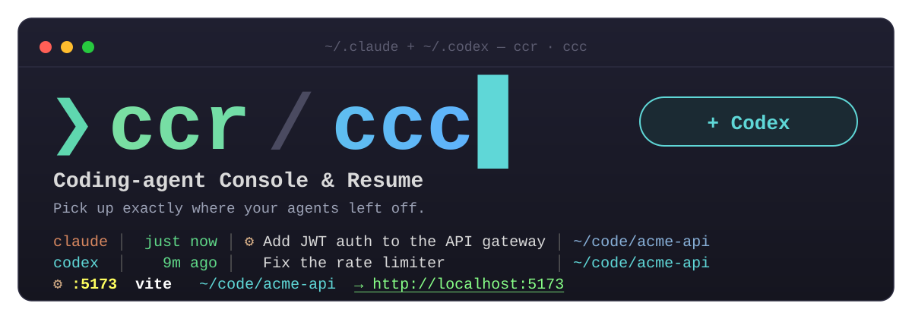

<p align="center">
  
</p>

<h3 align="center">CCR — Coding-agent Console &amp; Resume</h3>

<p align="center">
  <b>從 agent 停下的地方，無縫接續。</b><br>
  <code>ccr</code>：你的 Claude Code session · <code>ccc</code>：Claude Code + Codex 同一個列表
</p>

<p align="center">
  <a href="README.md">English</a> · <b>繁體中文</b>
</p>

---

CCR 是給 coding agent 用的終端機控制台。跨所有專案模糊搜尋 Claude Code 或 Codex 的
session，預覽它當時在做什麼、產出了什麼，選定後自動 `cd` 到專案目錄並
`claude --resume`（或 `codex resume`）。

## 為什麼用 CCR

- **⚙ 一眼看到整個工作現場**：agent 啟動的 dev server、port 與 watcher 直接列在
  session 列表上方，對應到所屬專案，附 CPU、記憶體與可點的 `localhost` 連結，
  resume 時全局盡在眼前。
- **🛟 每個 session 都找得到**：CCR 會告訴你 Claude 保留對話紀錄多久、怎麼延長，
  `Ctrl-X` 還能列出已清理的 session 與它的第一句 prompt。
- **🗂 一個列表，涵蓋所有來源**：Claude Code、Codex 與 Claude Desktop（Cowork）的
  session 放在一起，各自標上工具；Desktop 對話可以分支到 CLI 繼續。
- **✦ 清楚每個 session 的產出**：artifact 與 session 寫過的檔案以區塊呈現在預覽中，
  `Ctrl-L` 直接開啟。
- **🎨 打造你的風格**：`ccr --themes` 開啟即時主題選擇器，在真實的 CCR 畫面上瀏覽
  Tokyo Night、Catppuccin、Kanagawa、Gruvbox 與 Classic，24-bit 全彩，按 `Enter` 儲存。

全部只是一個 Bash 腳本加上 fzf：不需要常駐程式、不用編譯，`ccr --update` 一鍵更新。

<p align="center">
  
</p>

```
╭ ⚙ 背景 process · 2 ───────────────────────────────────────────────────────────────────────────╮
│  -       PID 4242   59.1% CPU   45 MB  webpack --watch    ~/payments                          │
│  :5173   PID 6060    0.0% CPU   38 MB  vite --port 5173  ~/acme-api  → http://localhost:5173  │
╰───────────────────────────────────────────────────────────────────────────────────────────────╯
╭ 🔍 搜尋 · time ───────────────────────────────────────────────────────────────────────────────╮
│ ❯ jwt                                                                                    3/14 │
╰───────────────────────────────────────────────────────────────────────────────────────────────╯
╭ Session 列表 ─────────────────────────────────────────────────────────────────────────────────╮
│▌   剛剛 │ ⚙✦ Add JWT auth to the API gateway         │ ~/code/acme-api                        │
│  2 分鐘前 │    修 checkout 不穩定的整合測試             │ ~/code/storefront                   │
╰───────────────────────────────────────────────────────────────────────────────────────────────╯
 Enter 開啟 ^R 遠端 ^F 分支 ^Y 只印 ^L 產出 ^X 已清理 ^T/^O/^G 排序
╭ 預覽 ─────────────────────────────────────────────────────────────────────────────────────────╮
│ 📌 Add JWT auth to the API gateway                                                            │
╰───────────────────────────────────────────────────────────────────────────────────────────────╯
```

> **0.6 新功能**：預設改用 Tokyo Night 主題，另外還有四種主題可選（`--theme`／
> `CCR_THEME`），以及 fzf ≥ 0.58 的分框版面。0.5 加入 artifact 與產生的檔案
> （`✦`、`Ctrl-L`），0.4 加入 `ccc`（Codex），0.3 加入 process 區，0.2 加入
> Desktop／已清理的 session 與分支續接。
> 詳見 [版本紀錄](#版本紀錄)。

## 功能

- [Session](#session)：列表裡會出現什麼
- [Resume](#resume)：選定之後會做什麼
- [Process 區](#process-區)：session 留在背景的 process
- [產出](#產出)：每個 session 產生的 artifact 與檔案
- [Codex（`ccc`）](#codexccc)：Claude Code 與 Codex 放在同一個列表
- [主題](#主題)：配色與分框版面
- [日常使用](#日常使用)：排序、顏色、語言、速度

### Session

| 功能 | 說明 |
| ---- | ---- |
| 跨專案掃描 | 掃 `~/.claude/projects/*/*.jsonl` 全部 session |
| 你取的名字優先 | 標題優先用 `/rename`、`claude -n` 取的名字，其次是 AI 標題、舊版 `summary`、第一句 prompt |
| Desktop 對話 | Claude Desktop 的 Cowork 對話以洋紅色顯示（`Desktop · <資料夾>`），以 `--fork-session` 在 CLI 開啟，Desktop 原對話不受影響 |
| 已清理的 session | Claude 會刪除超過 `cleanupPeriodDays`（預設 30 天）沒活動的對話；`Ctrl-X`／`ccr --expired` 以灰色列出仍留在 prompt 歷史裡的 session 和第一句 prompt，但無法 resume |
| 保留天數提醒 | `cleanupPeriodDays` 沒設定或小於 90 天時，選單標頭會提醒 |
| 預覽 | 標題、時間、工作目錄、session id、最後一次 prompt |

### Resume

| 功能 | 說明 |
| ---- | ---- |
| 一鍵 resume | `Enter` 直接切目錄並 `claude --resume` |
| 分支續接 | `Ctrl-F`（或 `ccr --fork`）以 `--fork-session` 開新 session id，原對話不受影響 |
| 手機接手 | `Ctrl-R` 加 `--remote-control`，用 Claude 手機 app／網頁繼續 |
| 快速 resume | `ccr --last`／`ccr -n N` 不開選單直接續 |
| 只印指令 | `Ctrl-Y` 印出 `cd … && claude --resume …`，不執行 |

### Process 區

| 功能 | 說明 |
| ---- | ---- |
| 背後還在跑什麼 | 列表上方獨立一區，依 CPU 排序列出所有 session 目錄底下還在跑的 process：agent 開來 demo 的 port（附 `http://localhost:<port>`）和 `tsc --watch` 這類 watcher，含 CPU、記憶體與所屬專案 |
| 高亮 | port 黃色、指令亮白、專案青色、連結綠色，CPU 達 50% 以上顯示紅色 |
| 標記 session | 有 process 的 session 標 `⚙`，resume 前也會印出 |
| 不列雜訊 | 不列 shell、coding agent 本身（`claude`、`codex`）與它們啟動的 MCP server；同一個 process tree 只列一筆 |

### 產出

| 功能 | 說明 |
| ---- | ---- |
| Artifacts | 發布過 claude.ai artifact 的 session，預覽會列出標題、版本數、最後更新時間、`claude.ai/code/artifact/…` 連結，以及本機原始檔（`✓`／`✗`） |
| 產生的檔案 | session 新增（`+`）或修改（`~`）的檔案，最新的在上，`✓`／`✗` 表示檔案是否還在。Claude Code 取自 `Write`／`Edit`，Codex 取自 `FileChange` 紀錄；暫存目錄與 scratchpad 的檔案不列 |
| `✦` 標記 | 有 artifact 或產生檔案的 session，在 `⚙` 旁標 `✦` |
| 開啟 | `Ctrl-L` 用瀏覽器開 artifact、用預設 App 開檔案；有多個時先跳出小選單挑選 |

### Codex（`ccc`）

| 功能 | 說明 |
| ---- | ---- |
| 一個列表看兩種工具 | Claude Code 與 Codex 的 session 放在一起排序 |
| 工具欄篩選 | 最前面一欄是 `claude`／`codex`，搜尋時輸入 `^codex`、`^claude` 就能篩選；`Ctrl-A` 切換來源 |

完整說明見下方 [`ccc`：Claude Code + Codex](#cccclaude-code--codex)。

### 主題

| 功能 | 說明 |
| ---- | ---- |
| 五種主題 | `tokyonight`（預設）、`catppuccin`、`kanagawa`、`gruvbox`、`classic`（0.6 以前的配色）。用 `ccr --theme gruvbox` 或 `CCR_THEME=catppuccin ccr` 切換（兩者都設定時 `--theme` 優先） |
| 色塊 | 各區塊標題是實心的色塊標籤，預覽裡每個小框也有淡淡的同色底（`classic` 維持原樣） |
| 主題選擇器 | `ccr --themes` 列出所有主題並即時預覽：右邊用目前選到的主題（含背景色）畫出縮小版的 ccr 畫面。`Enter` 套用並存到 `~/.config/ccr/theme`（`$XDG_CONFIG_HOME/ccr/theme`）；`Ctrl-Y` 只印出 `export CCR_THEME=…`。優先順序：`--theme` > `CCR_THEME` > 存下的主題 > `tokyonight` |
| Truecolor，可退回 256 色 | `$COLORTERM` 是 `truecolor`／`24bit` 時以 24-bit 全彩顯示，否則自動換成最接近的 xterm-256 色 |
| 分框版面 | process、搜尋、session 列表、預覽各自獨立成一個圓角框。需要 fzf ≥ 0.58（沒有的話 `brew upgrade fzf`）；版本較舊時自動退回單一邊框的 `classic` 版面，也可用 `CCR_LAYOUT=boxed`／`CCR_LAYOUT=classic` 強制指定。預覽框裡（兩種版面、任何 fzf 版本都有）再依內容分成「對話」「Artifacts」「產生的檔案」「最後的 prompt」幾個小框，寬度 ≥ 100 欄時左右兩欄，較窄時由上而下 |

### 日常使用

| 功能 | 說明 |
| ---- | ---- |
| 即時排序 | 時間／標題／目錄，選單內直接切換 |
| 彩色 + 對齊 | 時間依新舊上色，正確計算全形字寬度，中英混排也對齊 |
| 中英雙語 | 依 `$LANG` 自動偵測，可用 `--lang` 或 `CCR_LANG` 覆寫 |
| 快取加速 | 依檔案修改時間快取索引，沒變動的 session 不重複解析 |
| 零設定 | 單一 Bash 腳本，無背景程式 |

## 需求

- `bash`（3.2+，macOS 內建版本即可）
- [`fzf`](https://github.com/junegunn/fzf)——fzf ≥ 0.58 才有分框版面；
  版本較舊仍可使用，退回 classic 版面（`brew upgrade fzf` 可升級取得分框版面）
- `python3`
- `claude` CLI（實際 resume 時需要）
- `lsof`（選用，macOS 內建，用於 process 區）
- [`codex`](https://github.com/openai/codex) CLI（選用，只有用 `ccc` resume Codex session 時需要）

## 安裝

```sh
git clone https://github.com/kylinfish/coding-agent-console-resume.git
cd coding-agent-console-resume
./install.sh          # 連結 bin/ccr 與 bin/ccc 到 ~/.local/bin
./install.sh --tip    # 另外在 shell 啟動時加一行提示
```

也可以直接把 `bin/ccr` 放到任何 `PATH` 目錄下（有用 Codex 的話再建一個指向它的 `ccc` symlink）。

### 更新

`install.sh` 是把指令連結到你 clone 下來的目錄，所以更新那份 clone 就等於更新 `ccr`：

```sh
ccr --update             # 0.6.1 起：自動 git pull 並列出新版內容
```

如果還是 0.6.0 或更舊的版本，先在 clone 目錄手動更新一次（改名前 clone 的目錄仍叫
`claude-code-resume`），之後就能用 `--update`：

```sh
cd claude-code-resume && git pull
```

## 用法

| 指令 | 作用 |
| ---- | ---- |
| `ccr` | 列出所有 session，最新在上 |
| `ccr .` | 只看當前目錄（含子目錄）的 session |
| `ccr <path>` | 只看指定目錄（含子目錄）的 session |
| `ccr --last` | 不開選單，直接續最近一個 session |
| `ccr -n N` | 不開選單，直接續第 N 新的 session |
| `ccr --last --fork` | 把最近一個 session 分支成新的 session id |
| `ccr --expired` | 一併列出已被 Claude 清理的 session |
| `ccr -s title` | 依標題排序（`time`｜`title`｜`dir`） |
| `ccr --lang zh` | 強制中文介面（預設依 `$LANG` 自動偵測） |
| `ccr --theme gruvbox` | 切換主題（`tokyonight`（預設）｜`catppuccin`｜`kanagawa`｜`gruvbox`｜`classic`） |
| `ccr --themes` | 主題選擇器：即時預覽，Enter 套用並儲存 |
| `ccr --version` | 顯示版本 |
| `ccr --update` | 更新（git pull）並列出新版內容 |
| `ccr --help` | 顯示說明 |

### 選單內快捷鍵

| 按鍵 | 行為 |
| ---- | ---- |
| `Enter` | 開啟選定的 session |
| `Ctrl-R` | 開啟 **+ 手機遠端控制**（`--remote-control`） |
| `Ctrl-F` | 分支：以新的 session id 續接（`--fork-session`） |
| `Ctrl-Y` | 只印出 `cd … && claude --resume …` 指令，不執行 |
| `Ctrl-X` | 顯示／隱藏已清理的 session |
| `Ctrl-L` | 開啟 session 的 artifact 或產生的檔案（標 `✦` 的 session） |
| `Ctrl-A` | 僅 `ccc`：來源切換，全部 → Claude → Codex |
| `Ctrl-T` | 依時間排序 |
| `Ctrl-O` | 依標題排序 |
| `Ctrl-G` | 依工作目錄排序 |
| `Esc` | 取消 |

> 手機遠端控制需 Claude Pro/Max/Team/Enterprise 訂閱，且本機需持續開著並連網
>（手機只是視窗，運算仍跑在你電腦）。

## `ccc`：Claude Code + Codex

`ccr` 只看 Claude Code。`ccc` 是同一支腳本換個名字執行：`ccr` 的所有功能，再加上
[OpenAI Codex](https://github.com/openai/codex) 的 session，放在同一個列表。

```sh
ccc                      # Claude Code + Codex 的 session，最新在上
ccc --last               # 續兩邊之中最近的一個 session
ccc --version            # ccc 0.6.0
```

```
codex  │   9 分鐘前 │  ✦ 修 rate limiter                         │ ~/code/acme-api
claude │       剛剛 │ ⚙✦ Add JWT auth to the API gateway         │ ~/code/acme-api
claude │     1 天前 │    教團隊用 Claude Desktop                 │ Desktop · ~/code/handbook
```

| 項目 | 說明 |
| ---- | ---- |
| 工具欄 | 列表最前面一欄是 `claude` 或 `codex`；因為在行首，搜尋時輸入 `^codex` 或 `^claude` 就能依工具篩選（Desktop 與已清理的 session 算 `claude`）。Codex 的預覽顯示 branch、model、token 用量 |
| 動作 | `Enter` 執行 `codex resume <id>`，`Ctrl-F` 執行 `codex fork <id>`，`Ctrl-Y` 印出指令；Codex 沒有 Remote Control，`Ctrl-R` 會提示並取消 |
| 來源切換 | `Ctrl-A`：全部 → Claude → Codex |
| 過濾 | 只列互動式 thread（`cli`／`vscode` 來源、未封存），不列 subagent、review、MCP thread |
| 資料來源 | 以唯讀方式讀 `~/.codex/state_*.sqlite`；這是 Codex 內部、會改版的格式，所以依欄位名稱讀取，讀不到時改讀 `~/.codex/sessions/**/rollout-*.jsonl`；可用 `CODEX_HOME` 指定其他位置 |
| Process 區 | 也涵蓋 Codex 專案，且不會列出 `codex` 本身與它啟動的 MCP server |

## 環境變數

| 變數 | 用途 |
| ---- | ---- |
| `CCR_LANG` | `zh` 或 `en`，覆寫介面語言 |
| `CCR_PROJECTS_DIR` | 直接覆寫掃描路徑 |
| `CLAUDE_CONFIG_DIR` | Claude 設定目錄；`ccr` 會掃 `$CLAUDE_CONFIG_DIR/projects` |
| `CCR_CACHE` | 覆寫索引快取目錄（預設 `~/.cache/ccr`） |
| `CCR_DESKTOP_DIR` | 覆寫 Claude Desktop Cowork 對話的路徑 |
| `CCR_HISTORY_FILE` | 覆寫 prompt 歷史檔（預設 `~/.claude/history.jsonl`） |
| `CCR_THEME` | 主題：`tokyonight`（預設）、`catppuccin`、`kanagawa`、`gruvbox`、`classic`；會蓋過 `ccr --themes` 存下的主題 |
| `CCR_LAYOUT` | `boxed` 或 `classic`（預設：fzf ≥ 0.58 用 `boxed`，否則 `classic`） |
| `CODEX_HOME` | `ccc`：Codex 的目錄（預設 `~/.codex`） |
| `CCR_CODEX` | 設為 `1` 時，以 `ccr` 執行也會列出 Codex session |

> 掃描路徑優先序：`CCR_PROJECTS_DIR` → `$CLAUDE_CONFIG_DIR/projects` → `~/.claude/projects`。

## 運作原理

- **CLI session**：每個 Claude Code session 是 `~/.claude/projects/<slug>/` 底下的一個 `.jsonl`。`ccr` 讀出標題（你 `/rename` 的名字優先，其次 `ai-title`、`summary`、第一句 prompt）、最後一句 prompt、工作目錄與修改時間，交給 `fzf` 顯示；選定後執行 `cd "$cwd" && claude --resume "$sessionId"`。
- **Desktop 對話**：Cowork 對話在 `~/Library/Application Support/Claude/local-agent-mode-sessions/`，`local_<id>.json` 存標題、最後活動時間與授權資料夾，旁邊的沙盒資料夾存對話紀錄。`ccr` 以對話檔路徑加 `--fork-session` 開啟，新對話存成一般 CLI session，Desktop 的原檔不會被寫入。
- **已清理的 session**：Claude Code 預設會刪除 30 天沒活動的對話紀錄，但 prompt 仍留在 `~/.claude/history.jsonl`，已清理的列就是從這裡來的。想保留更久，在 `~/.claude/settings.json` 加上：

  ```json
  { "cleanupPeriodDays": 365 }
  ```

- **Process 區**：一次 `ps`，加上 `lsof` 取得 listen 的 TCP port 與工作目錄，快取 5 秒。有 listen port 或執行已知開發指令（vite、next、tsc、nodemon、python…），且工作目錄在某個 session 目錄底下的 process 才會列出（以最深的目錄為準；`$HOME` 與 `/` 不算）。不列 shell、coding agent 與它們啟動的 MCP server，同一個 process tree 只留一筆，有 port 的優先。
- **產出**：artifact 來自 Claude Code 每次發布時寫入的 `frame-link` 紀錄（標題、連結、本機檔案、時間）；產生的檔案來自 `Write`／`Edit`／`NotebookEdit` 工具呼叫，Codex 則來自每個 thread rollout 檔裡的 `FileChange`。兩者都在掃描時整理並跟索引一起快取，之後啟動不會變慢。
- **排序與快取**：排序在掃描時完成，選單內切換排序只是重新載入列表。依檔案修改時間快取索引（`~/.cache/ccr`），沒變動的 session 不重複解析，數百個 session 也能快速啟動。

## 版本紀錄

| 版本 | 重點 |
| ---- | ---- |
| [0.6.1](docs/releases/v0.6.1.md) | `ccr --update`：直接更新 git 安裝並列出新版內容 |
| [0.6.0](docs/releases/v0.6.0.md) | 預設改用 Tokyo Night 主題，另外還有四種主題（`--theme`／`CCR_THEME`），fzf ≥ 0.58 的分框版面，舊版 fzf 自動退回有主題的 `classic` 版面 |
| [0.5.0](docs/releases/v0.5.0.md) | 每個 session 的 artifact 與產生的檔案（`✦`、`Ctrl-L`）、process 區顯示改進、README 分語系、demo 資料、測試 |
| [0.4.0](docs/releases/v0.4.0.md) | `ccc`：Claude Code 與 Codex 的 session 放在同一個選單，含 `claude`／`codex` 工具欄與 `Ctrl-A` 來源切換 |
| [0.3.0](docs/releases/v0.3.0.md) | Process 區：列出 session 專案底下仍在跑的 port 與 watcher，高亮顯示並以 `⚙` 標記 session |
| [0.2.0](docs/releases/v0.2.0.md) | 不只 CLI：Claude Desktop 與已清理的 session、保留天數提醒、`/rename` 標題、分支續接、`--version` |
| 0.1.0 | 初版 |

完整內容請見 [CHANGELOG](CHANGELOG.md)（英文）。

## 授權

[MIT](./LICENSE) © 2026 kylinfish
